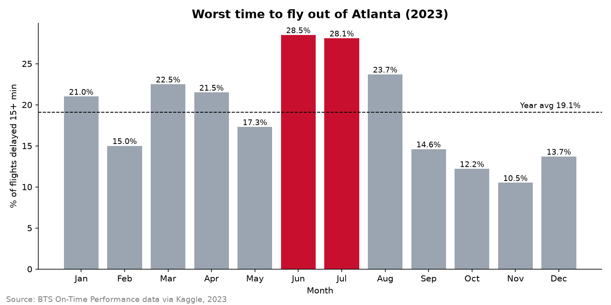
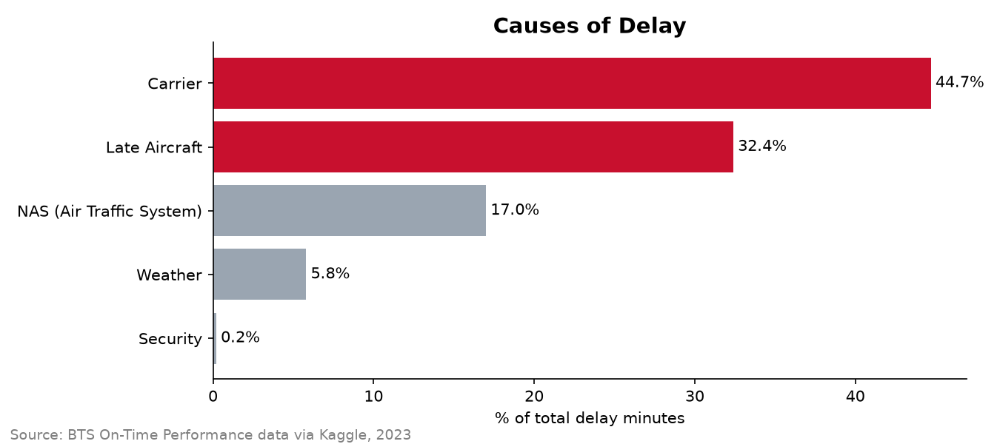
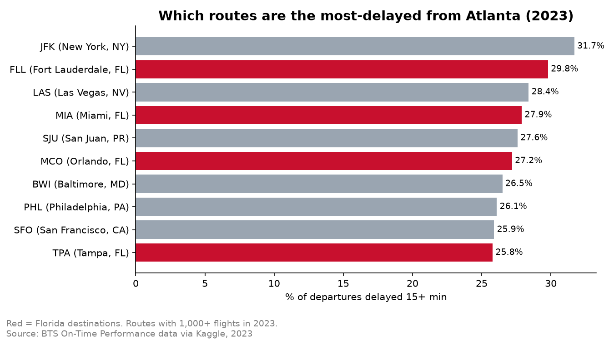
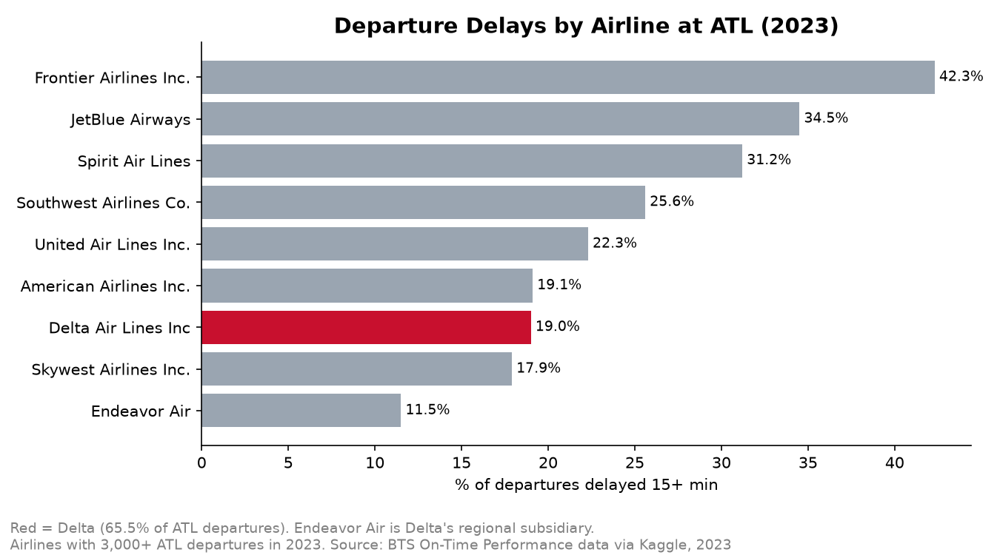
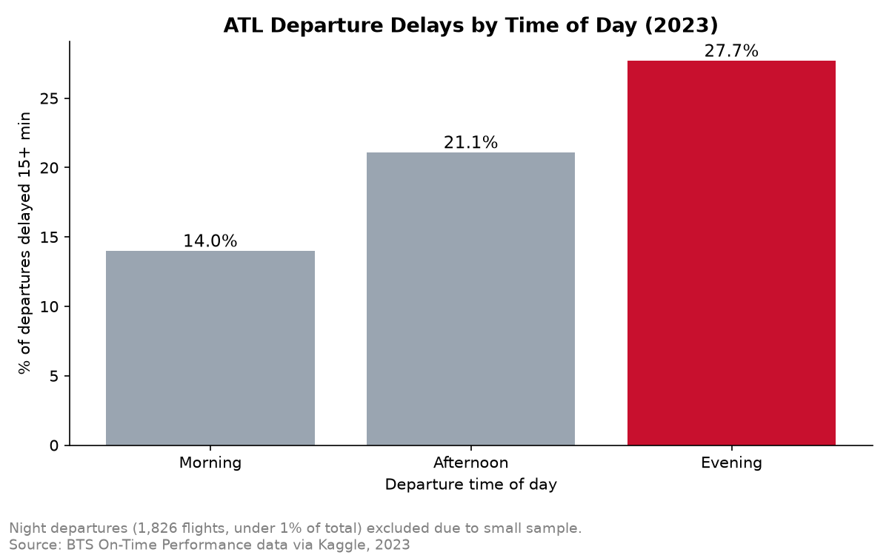

# What Drives Flight Delays at Atlanta's Airport? (2023)

An analysis of 665,876 flights to and from Hartsfield-Jackson Atlanta International Airport (ATL) to find **when**, **why**, **where**, and **for which airlines** delays happen, and what could be done about them.

**Tools:** Python (pandas, matplotlib) · SQL (DuckDB) · Jupyter Notebook

---

## Key Findings

1. **About 1 in 5 ATL departures is delayed.** 20.6% of flights leaving ATL in 2023 departed 15+ minutes late (the industry definition of a delay).
2. **Summer is the worst time to fly.** June (28.5%) and July (28.1%) had the highest delay rates for flights to and from ATL, nearly triple November's 10.5%, even though monthly flight volume stayed similar.
3. **Airline operations cause most delays, not weather.** 77% of delay minutes came from carrier issues (44.7%) and late-arriving aircraft (32.4%). Extreme weather accounted for only 5.8%.
4. **Delays snowball through the day.** 14.0% of morning departures were delayed vs. 27.7% in the evening. Over the same period, the share of delay minutes caused by late-arriving aircraft rose from 19.8% to 34.5%.
5. **Florida routes stand out.** 4 of the 10 most-delayed routes from ATL go to Florida. New York JFK was the single worst route at 31.7%, about 54% above the ATL average.
6. **Delta beats the airport average; low-cost carriers lag.** Delta operates 65.5% of ATL departures and was delayed 19.0% of the time, below the 20.6% average. Frontier was delayed 42.3% of the time, more than double Delta's rate.

---

## Business Questions

1. Which months have the worst delays at ATL?
2. What causes most delays: the airline, late-arriving aircraft, the air traffic system, weather, or security?
3. Which routes out of ATL are delayed most often?
4. How does Delta compare to other airlines at ATL?
5. Do delays build up as the day goes on?

---

## Results

### 1. Delays by month

Summer is the clear peak. Breaking delays down by cause and month showed that summer isn't mainly a weather story: July had **3.6× more delay minutes** than November, and every cause increased. Late-arriving aircraft reached their highest share in June and July (about 35%), suggesting tight summer schedules amplify small delays.

### 2. Causes of delay

Carrier delays (maintenance, crew, cleaning, fueling, baggage) and late-arriving aircraft together make up 77% of about **8.2 million delay minutes**.

*Note:* In this data, "Weather" only covers extreme weather. Ordinary weather that slows air traffic is recorded under NAS (Air Traffic System), so weather's true impact is somewhat larger than 5.8%.

### 3. Most-delayed routes from ATL

Fort Lauderdale, Miami, Orlando, and Tampa all rank in the top 10, alongside congested Northeast airports (JFK, Baltimore, Philadelphia). By volume, **Orlando has the biggest impact**: with 8,960 flights at a 27.2% delay rate, it had roughly 2,400 delayed departures.

### 4. Airlines compared

Delta dominates ATL and performs better than the airport average. Endeavor Air, Delta's wholly owned regional airline, was among the best performers at 11.5%. Low-cost carriers (Frontier, JetBlue, Spirit) had the highest delay rates, likely because they fly aircraft more hours per day with less slack between flights.

### 5. Delays by time of day

Morning flights start fresh after aircraft sit overnight. As the day goes on, each late arrival pushes back the next departure, so evening flights are twice as likely to be delayed.

---

## Recommendations

1. **Add buffer time between flights in the afternoon and evening, especially in summer.** Late-arriving aircraft are the largest controllable driver of delays, and their impact grows through the day and peaks in June and July.
2. **Focus improvement efforts on high-volume, high-delay routes.** Routes like Orlando affect more passengers than lower-volume routes with slightly higher delay rates.
3. **For travelers:** book morning flights and avoid summer travel when possible.

---

## Data

- **Source:** U.S. Bureau of Transportation Statistics (BTS) On-Time Performance data, via the Kaggle dataset [US 2023 Civil Flights, Delays, Meteo and Aircrafts](https://www.kaggle.com/datasets/bordanova/2023-us-civil-flights-delay-meteo-and-aircraft).
- **Scope:** 6,743,404 U.S. domestic flights in 2023, filtered to the 665,876 flights departing from or arriving at ATL (about 10% of the national total).
- Cancelled and diverted flights are stored in a separate file and are excluded from this analysis.
- The data files are not included in this repository because of their size. Download them from the Kaggle link above to rerun the notebooks.

---

## Data Cleaning

1. Filtered the national dataset to flights departing from or arriving at ATL.
2. Converted `FlightDate` from text to a date and added `Month` and `Month_Name` columns.
3. Renamed `Aicraft_age` to `Aircraft_Age` to fix a typo in the source data.
4. **Rebuilt the delay flags.** The dataset's original `Dep_Delay_Tag` marked any delay of 1+ minute as delayed, which would have reported 37.1% of flights as delayed. I replaced it with `Dep_Delay_15` and `Arr_Delay_Tag` using the 15-minute industry standard.
5. Kept extreme delays (up to 54 hours) as real events. Because delays are heavily right-skewed (mean departure delay 11.3 min vs. median -1 min), results use the **% of flights delayed 15+ minutes** and the **median** rather than the average.
6. Confirmed there were no missing values.

---

## How Metrics Are Defined

- **Delayed:** departed (or arrived) 15+ minutes after the scheduled time.
- **Monthly results and delay causes** use all flights to and from ATL.
- **Route, airline, and time-of-day results** use departures from ATL only. The ATL departure average is 20.6%.
- **Routes and airlines** were limited to those with 1,000+ and 3,000+ ATL departures respectively, so small samples don't distort the rankings.

---

## Limitations and Next Steps

- One year of data (2023); patterns may differ in other years.
- Departure delays at ATL can be caused by congestion at the destination (air traffic control ground holds), so route results don't necessarily reflect problems at ATL itself.
- **Next steps:** compare delay causes for the worst routes; test whether low-cost carriers explain the Florida route pattern; add the weather table to measure weather impact directly; analyze aircraft age; build an interactive Tableau dashboard.

---

## Repository Structure

| File | Description |
|---|---|
| `01_load_data.ipynb` | Loads the national data, filters to ATL, and cleans it |
| `02_sql_analysis.ipynb` | Answers the five business questions with SQL (DuckDB) |
| `03_charts.ipynb` | Builds the charts with matplotlib |
| `results_*.csv` | Summary tables from each SQL query |
| `chart*.png` | Final charts |

---

**Author:** Mohamed Abdella · MIS, University of Georgia (Terry College of Business)
